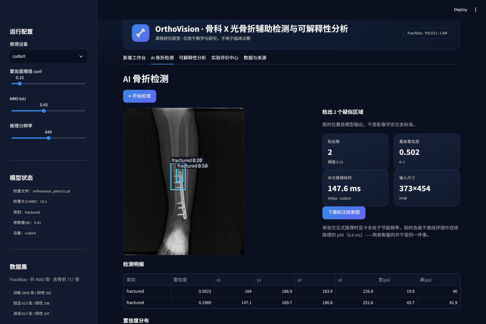
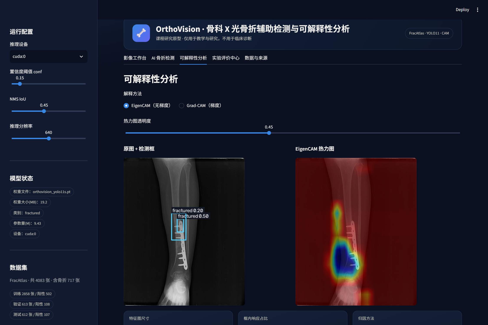
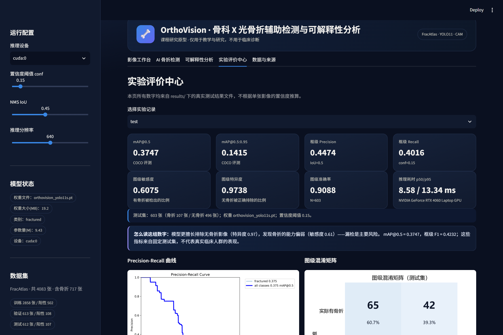
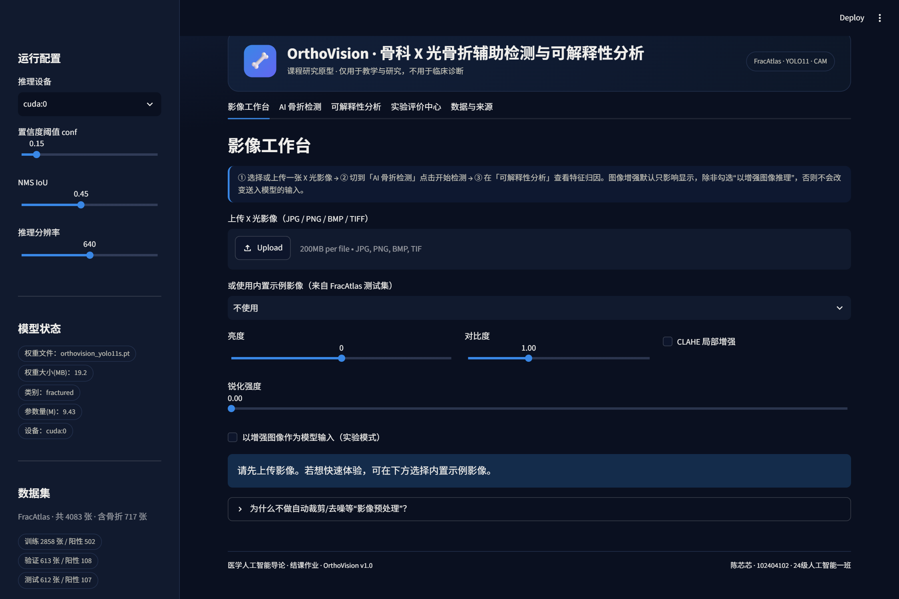

# OrthoVision · 骨科 X 光骨折辅助检测与可解释性分析

> 《医学人工智能导论》课程结课项目 —— 一个**真实推理**、**带实验评价**的医学影像 AI 研究原型。
>
> ⚠️ 本项目仅用于教学与研究，**不能用于临床诊断**。

OrthoVision 把"检测模型"和"模型可信度分析"放进同一个系统：上传一张 X 光片，模型给出疑似骨折区域的边界框与置信度，系统同时展示特征响应热力图，并在独立的测试集上报告可复现的指标、错误案例与图像扰动敏感性。

---

## 界面预览

| AI 骨折检测                                         | 可解释性分析                                      |
| ----------------------------------------------- | ------------------------------------------- |
|  |  |

| 实验评价中心                                      | 影像工作台                                           |
| ------------------------------------------- | ----------------------------------------------- |
|  |  |

> 以上截图由 Playwright 驱动本机 Edge 对真实运行中的系统截取，未做任何后期合成。

本仓库提供可复现的课程研究代码、实验记录与可视化结果；课程论文单独提交，不随公开仓库发布。
本仓库公开了主要实验指标、逐图评测记录及相关可视化结果，具体文件见 `results/`。论文中的实验结论应结合相应实验记录与方法说明理解。

---

## 1. 它解决了什么问题

骨折在急诊与骨科门诊中极其常见，而基层放射科医师阅片负荷大。深度学习检测模型可以提供"第二双眼睛"，但直接部署一个黑箱模型并不等于解决了问题：

- 模型在哪些图像上会漏检？
- 它"看"的是骨折线，还是石膏、钢板这类高对比结构？
- 影像质量下降（模糊、曝光不足）时，结果会崩多快？

本项目不追求提出新算法，而是把**一个真实训练出来的检测模型**放进可交互系统，并用**可复现的实验**回答上面三个问题。

### 系统能做什么 / 不能做什么

| 能                           | 不能                 |
| --------------------------- | ------------------ |
| 对单张 X 光输出疑似骨折区域的框与置信度       | 给出"骨折/正常"的临床诊断     |
| 展示特征响应热力图，辅助理解模型关注区域        | 把热力图当作病灶定位或分割结果    |
| 在固定测试集上报告 mAP、敏感度、特异度等可复现指标 | 把指标外推到真实临床人群       |
| 量化模型对模糊/亮度/噪声等可控扰动的敏感性      | 用扰动实验代表真实成像条件差异的影响 |

---

## 2. 快速开始

### 2.1 环境

```bash
conda create -n orthovision python=3.11 -y
conda activate orthovision

# Windows 上 PyPI 的 torch 是 CPU 版，训练会很慢，请用 CUDA 源：
pip install torch torchvision --index-url https://download.pytorch.org/whl/cu126
pip install -r requirements.txt
```

### 2.2 获取数据（不随仓库分发）

1. 从 figshare 下载 FracAtlas（article 22363012，CC BY 4.0），解压后将得到 `FractureAtlas/` 目录。
2. 转换成 YOLO 结构并生成固定划分：

```bash
python scripts/prepare_data.py --src "D:/path/to/FractureAtlas" --out data/fracatlas_yolo
```

输出：`data/fracatlas_yolo/{train,val,test}/{images,labels}` + `data.yaml` + `dataset_stats.json`。

### 2.3 训练

```bash
python scripts/train.py --epochs 80 --batch 16 --imgsz 640
```

训练完成后权重自动复制到 `weights/orthovision_yolo11s.pt`。

### 2.4 评测

```bash
python scripts/select_threshold.py          # 在验证集上选工作点阈值
python scripts/evaluate.py --split test     # mAP + 逐图 TP/FP/FN 记录
python scripts/error_analysis.py            # 误检/漏检的量化统计
python scripts/perturbation_experiment.py   # 图像质量扰动实验
python scripts/make_figures.py              # 论文用图
python scripts/update_readme.py             # 把指标写回本 README
```

结果写入 `results/`（JSON / CSV / PNG），界面直接读取这些文件。

### 2.5 启动界面

```bash
streamlit run app.py
```

浏览器打开后依次是：影像工作台 → AI 骨折检测 → 可解释性分析 → 实验评价中心。

---

## 3. 项目结构

```
OrthoVision/
├── app.py                      # Streamlit 界面（5 个页签）
├── orthovision/
│   ├── config.py               # 路径与默认参数
│   ├── detector.py             # YOLO 推理封装、耗时测量
│   ├── explain.py              # Eigen-CAM / Grad-CAM（面向检测头）
│   ├── metrics.py              # 框级匹配、图级敏感度/特异度
│   └── image_ops.py            # 显示增强、可控扰动、可视化
├── scripts/
│   ├── prepare_data.py         # FracAtlas -> YOLO + 固定划分
│   ├── train.py                # 微调 YOLO11-S
│   ├── select_threshold.py     # 验证集阈值扫描与工作点选择
│   ├── evaluate.py             # mAP + 逐图 TP/FP/FN 记录
│   ├── error_analysis.py       # 漏检病灶尺度 / 误检置信度统计
│   ├── perturbation_experiment.py
│   ├── make_figures.py         # 论文插图
│   └── update_readme.py        # 结果表回写 README
├── results/                    # 实验产物（JSON/CSV/图）
├── data/                       # 数据集（gitignore）
├── weights/                    # 模型权重（gitignore，见 Releases）
├── THIRD_PARTY.md              # 第三方资源、来源与许可
└── docs/                       # 补充文档
```

---

## 4. 方法与实现要点

### 4.1 检测模型

- 骨干：Ultralytics **YOLO11-S**（COCO 预训练），在 FracAtlas 上微调。
- 单类别 `fractured`；输入 640×640；NMS IoU 0.45。
- 由于 X 光为灰度影像，训练时关闭 HSV 色彩增强、关闭左右/上下翻转（左右侧在影像学上有意义），保留轻度旋转/平移/缩放与 mosaic。

### 4.2 可解释性

在检测头所消费的多尺度特征图上计算两类 CAM：

- **Eigen-CAM**：对 P5 特征图做 PCA，取第一主成分，无需梯度，对检测器更稳定；
- **Grad-CAM**：以"所选层自身预测切片中的最高类别得分"为标量反传。这一步是必需的——
  若直接对全局最高得分反传，梯度几乎只落在最细的 P3 层，P5 层得到零梯度，热力图会退化为全图零值。
  实现中若所选层激活退化，会自动回退到梯度最强的层，并在结果中注明实际使用的层级。

并计算"**框内响应占比**"——CAM 能量落在预测框内的比例，作为"模型说哪里、特征就在哪里响应"的粗粒度一致性检查。

> 这两者都**不是**骨折分割，也不能证明模型识别的是骨折线。钢板、石膏、体表标记等高对比结构常产生强响应，这一点在论文讨论部分专门分析。

### 4.3 指标定义

- **框级**：TP/FP/FN 按贪心 IoU≥0.5 匹配，报 Precision / Recall / F1；mAP@0.5、mAP@0.5:0.95 由 COCO 协议计算。
- **图级**（更接近筛查用途）：图像中是否检出任意骨折框 → 敏感度 / 特异度 / 准确率 / PPV / NPV。
- **耗时**：结束同步后的墙钟时间，记录 mean / p50 / p95，硬件在结果 JSON 中注明。

---

## 5. 实验结果

> 以下数字由 `scripts/evaluate.py` 在 FracAtlas 测试集上产生（原始 612 张，其中 9 张源文件为截断 JPEG 无法解码而跳过，实际评测 **603 张**，含骨折 107 张），原始记录见 `results/eval_test.json`。

| 指标           | 数值         | 说明                                        |
| ------------ | ---------- | ----------------------------------------- |
| mAP@0.5      | **0.3747** | COCO 协议                                   |
| mAP@0.5:0.95 | 0.1415     | 定位精度更严格                                   |
| 框级 Precision | 0.4474     | conf=0.15, IoU=0.5                        |
| 框级 Recall    | 0.4016     | 同上                                        |
| 框级 F1        | 0.4232     | 同上                                        |
| 图级敏感度        | 0.6075     | 含骨折图像被检出的比例                               |
| 图级特异度        | 0.9738     | 无骨折图像被正确排除的比例                             |
| 图级准确率        | 0.9088     | 样本不平衡下参考价值有限                              |
| 推理耗时 p50     | 8.58 ms    | NVIDIA GeForce RTX 4060 Laptop GPU, 640px |
| 推理耗时 p95     | 13.34 ms   | 同上                                        |

测试集规模：603 张（含骨折 107 / 无骨折 496）。
运行环境：PyTorch 2.14.1+cu126，NVIDIA GeForce RTX 4060 Laptop GPU。

---

## 6. 资源来源与许可

完整说明见 **[THIRD_PARTY.md](THIRD_PARTY.md)**，要点：

| 资源                | 来源                                                     | 许可                            | 本项目如何使用                               |
| ----------------- | ------------------------------------------------------ | ----------------------------- | ------------------------------------- |
| FracAtlas 数据集     | Abedeen et al., *Data in Brief* 2023；figshare 22363012 | **CC BY 4.0**                 | 仅使用 YOLO 标注，重新划分 train/val/test，未改动标签 |
| Ultralytics YOLO  | https://github.com/ultralytics/ultralytics             | **AGPL-3.0**                  | 作为依赖调用，未改源码                           |
| `yolo11s.pt` 初始权重 | Ultralytics 官方发布                                       | AGPL-3.0                      | 微调起点                                  |
| 本项目代码             | 本仓库                                                    | MIT                           | ——                                    |
| 本项目训练权重           | 本仓库 Releases                                           | **AGPL-3.0**（继承自 Ultralytics） | ——                                    |

**模型权重**未提交进 git（体积与许可原因），请从 Releases 下载 `orthovision_yolo11s.pt` 放入 `weights/`。

---

## 7. 引用

```bibtex
@article{abedeen2023fracatlas,
  title   = {FracAtlas: A Dataset for Fracture Classification, Localization and Segmentation of Musculoskeletal Radiographs},
  author  = {Abedeen, Iftekharul and Rahman, Md. Ashiqur and Prottyasha, Fatema Zohra
             and Ahmed, Tasnim and Chowdhury, Tareque Mohmud and Shatabda, Swakkhar},
  journal = {Data in Brief},
  volume  = {51},
  pages   = {109684},
  year    = {2023}
}

@misc{jocher2024ultralytics,
  title  = {Ultralytics YOLO},
  author = {Jocher, Glenn and Qiu, Jing and Chaurasia, Ayush},
  year   = {2024},
  url    = {https://github.com/ultralytics/ultralytics}
}
```

---

## 8. 常见问题

**Q：为什么测试集 mAP 不算高？**
A：FracAtlas 只有 717 张阳性图、922 个框，且骨折线在 X 光上本身对比度低、边界模糊。模型规模（YOLO11-S）与训练预算（单卡 1 小时）都受课程条件限制。论文第 5 章专门讨论了这一点，没有为了数字好看而做选择性报告。

**Q：为什么不做分类（有病/没病）？**
A：本项目选择目标检测，因为"在哪里"比"有没有"更能体现医学影像 AI 的可解释性需求。图级敏感度/特异度由检测结果导出，作为筛查用途的参考。

**Q：界面里的热力图是假的吗？**
A：不是。它由特征图真实计算；若当前环境无法计算，界面会明确提示并隐藏该视图，不会生成替代图。
