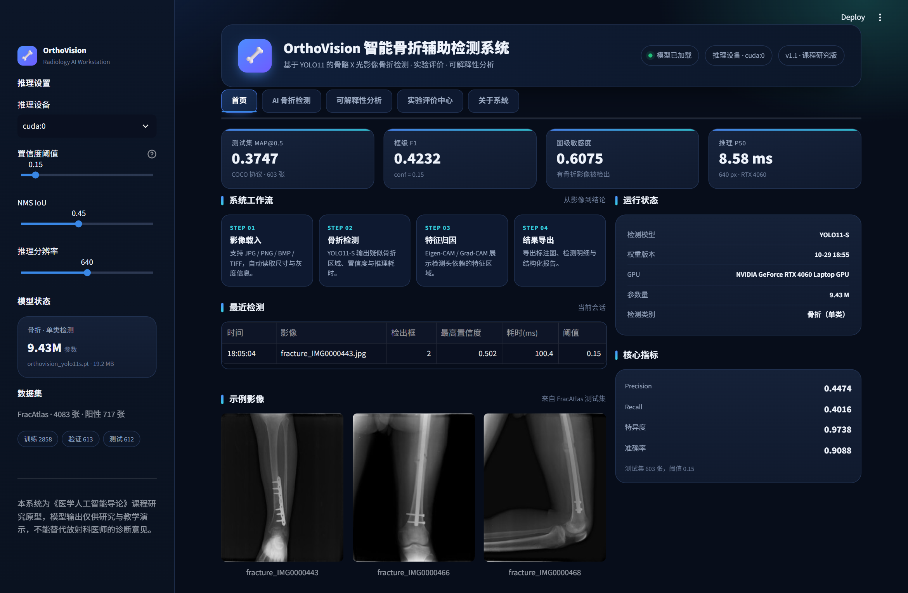
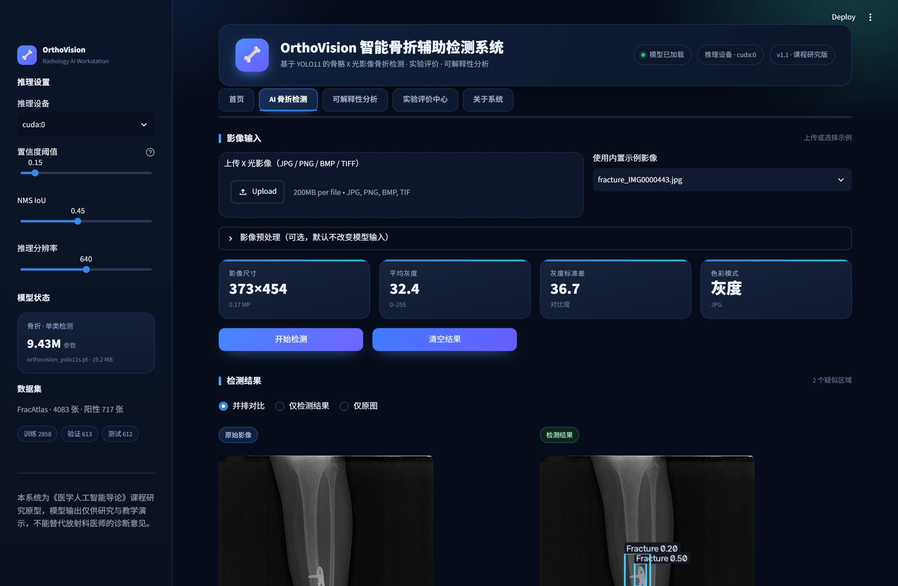
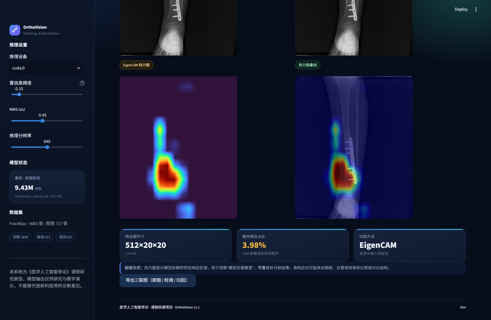
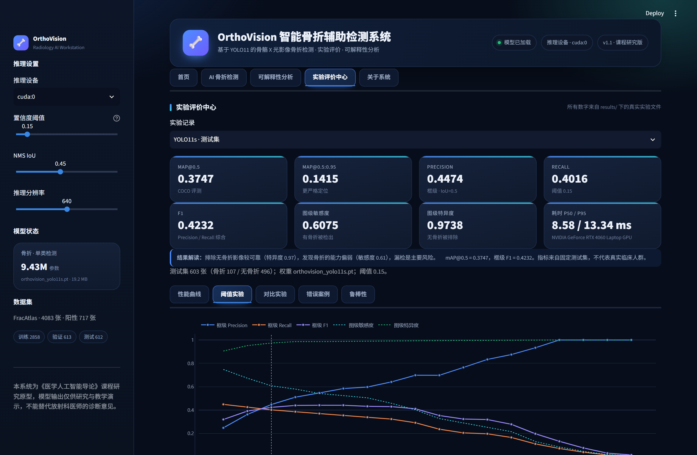

# OrthoVision · 智能骨折辅助检测与可解释性分析

> 《医学人工智能导论》课程结课项目 —— 一个**真实推理**、**带对照实验**的医学影像 AI 研究原型。
>
> ⚠️ 本项目仅用于教学与研究，**不能用于临床诊断**。

<p>
  
  
  
  
  
</p>

OrthoVision 把“检测模型”和“模型可信度分析”放进同一个系统：上传一张 X 光片，模型给出疑似骨折区域的边界框与置信度，系统同时展示特征响应热力图，并在独立测试集上报告可复现的指标、对照实验、错误案例与图像扰动敏感性。

---

## 界面预览

| 首页 · 影像工作站                                   | AI 骨折检测 · 并排对比                            |
| --------------------------------------------- | -------------------------------------------- |
|  |  |

| 可解释性分析 · 热力图                                 | 实验评价中心 · 阈值实验                              |
| --------------------------------------------- | ------------------------------------------ |
|  |  |

> 以上截图由 Playwright 驱动本机 Edge 对真实运行中的系统截取，未做后期合成。

---

## 1. 项目简介

骨折是急诊与骨科门诊中最常见的诊断问题之一，X 光平片是首选影像学检查。深度学习检测模型可以提供“第二双眼睛”，但直接部署一个黑箱模型并不等于解决了问题：

- 模型在哪些图像上会漏检？
- 它“看”的是骨折线，还是石膏、钢板这类高对比结构？
- 阈值变化、影像质量下降时，结果会怎样变化？

本项目不追求提出新算法，而是把**一个真实训练出来的检测模型**放进可交互系统，并用**可复现的对照实验**回答上面三个问题。

### 核心特性

- **真实推理**：所有检测结果来自 YOLO11 权重，不使用随机数或预设结果。
- **完整评价**：mAP@0.5、mAP@0.5:0.95、框级 P/R/F1、图级敏感度/特异度、推理耗时。
- **三组对照实验**：YOLO11n vs YOLO11s、置信度阈值扫描、原图 vs CLAHE 增强。
- **可解释性**：Eigen-CAM / Grad-CAM，四宫格展示原图、检测框、热力图与叠加图。
- **可追溯**：界面中的每个数字都读取自 `results/` 下的实验文件，论文由同一批文件生成。

---

## 2. 系统页面

| 页面        | 内容                                                       |
| --------- | -------------------------------------------------------- |
| 首页        | 模型/GPU/权重状态、核心指标、工作流、最近检测记录、示例影像                       |
| AI 骨折检测   | 上传或选择示例；并排对比/仅结果/仅原图；置信度分布；导出标注图、CSV、Markdown 报告       |
| 可解释性分析    | 原图 / 检测框 / 纯热力图 / 热力图叠加；框内响应占比；导出三联图                    |
| 实验评价中心    | 性能曲线、阈值实验、模型对比、增强对比、错误案例、鲁棒性、报告导出                       |
| 关于系统      | 数据集、模型、依赖来源与许可；系统能力边界                                   |

---

## 3. 快速开始

### 3.1 环境

```bash
conda create -n orthovision python=3.11 -y
conda activate orthovision

# Windows 上 PyPI 的 torch 是 CPU 版，训练会很慢，请用 CUDA 源：
pip install torch torchvision --index-url https://download.pytorch.org/whl/cu126
pip install -r requirements.txt
```

### 3.2 获取数据（不随仓库分发）

1. 从 figshare 下载 FracAtlas（article 22363012，CC BY 4.0），解压得到 `FractureAtlas/`。
2. 转换成 YOLO 结构并生成固定划分：

```bash
python scripts/prepare_data.py --src "D:/path/to/FractureAtlas" --out data/fracatlas_yolo
```

输出：`data/fracatlas_yolo/{train,val,test}/{images,labels}` + `data.yaml` + `dataset_stats.json`。

### 3.3 训练

```bash
# 主模型 YOLO11s
python scripts/train.py --epochs 80 --batch 16 --imgsz 640

# 对比模型 YOLO11n（可选）
python scripts/train.py --model weights/yolo11n_coco_pretrain.pt \
    --epochs 80 --batch 16 --name orthovision_yolo11n
```

训练完成后权重自动复制到 `weights/orthovision_yolo11s.pt`（对比模型为 `weights/orthovision_yolo11n.pt`）。

### 3.4 评测与实验

```bash
python scripts/select_threshold.py                 # 验证集选工作点阈值
python scripts/evaluate.py --split test            # 主模型 mAP + 逐图记录
python scripts/threshold_experiment.py --split test  # 测试集阈值扫描
python scripts/enhancement_experiment.py --split test # 原图 vs CLAHE
python scripts/error_analysis.py                   # 误检/漏检量化
python scripts/perturbation_experiment.py          # 图像质量扰动
python scripts/build_comparison.py                 # YOLO11n / YOLO11s 汇总
python scripts/make_figures.py                     # 论文插图
python scripts/update_readme.py                    # 指标回写 README
```

结果写入 `results/`（JSON / CSV / PNG），界面直接读取这些文件。

### 3.5 启动界面

```bash
streamlit run app.py
```

浏览器打开后依次是：首页 → AI 骨折检测 → 可解释性分析 → 实验评价中心 → 关于系统。

---

## 4. 实验结果

> 以下数字由 `scripts/evaluate.py` 等在 FracAtlas 测试集上产生（原始 612 张，其中 9 张源文件为截断 JPEG 无法解码而跳过，实际评测 **603 张**，含骨折 107 张）。原始记录见 `results/eval_test.json`。

### 4.1 主模型测试集表现

<!-- RESULTS_TABLE -->
| 指标 | 数值 | 说明 |
| --- | --- | --- |
| mAP@0.5 | **0.3747** | COCO 协议 |
| mAP@0.5:0.95 | 0.1415 | 定位精度更严格 |
| 框级 Precision | 0.4474 | conf=0.15, IoU=0.5 |
| 框级 Recall | 0.4016 | 同上 |
| 框级 F1 | 0.4232 | 同上 |
| 图级敏感度 | 0.6075 | 含骨折图像被检出的比例 |
| 图级特异度 | 0.9738 | 无骨折图像被正确排除的比例 |
| 图级准确率 | 0.9088 | 样本不平衡下参考价值有限 |
| 推理耗时 p50 | 8.58 ms | NVIDIA GeForce RTX 4060 Laptop GPU, 640px |
| 推理耗时 p95 | 13.34 ms | 同上 |

测试集规模：603 张（含骨折 107 / 无骨折 496）。
运行环境：PyTorch 2.14.1+cu126，NVIDIA GeForce RTX 4060 Laptop GPU。
<!-- /RESULTS_TABLE -->

### 4.2 模型规模对比

| 模型      | 参数量   | mAP@0.5    | 框级 F1    | 图级敏感度  | p50 延迟（同条件） |
| ------- | ----- | ---------- | -------- | ------ | ----------- |
| YOLO11n | 2.60M | **0.3948** | **0.4453** | 0.6636 | 11.97 ms    |
| YOLO11s | 9.43M | 0.3747     | 0.4232   | 0.6075 | 12.15 ms    |

对比结果由 `scripts/build_comparison.py` 生成，完整表格见 `results/model_comparison.json`。
延迟来自 `scripts/benchmark_latency.py` 的同条件连续测量（200 张、预热、CUDA 同步）；
评测脚本当时的墙钟 p50 分别为 13.07 / 8.58 ms，受运行时负载影响，不作为模型对比依据。

### 4.3 置信度阈值扫描（测试集）

| 阈值   | 框级 Precision | 框级 Recall | 框级 F1    | 图级敏感度  | 图级特异度  |
| ---- | ------------ | --------- | -------- | ------ | ------ |
| 0.10 | 0.3624       | 0.4252    | 0.3913   | 0.6729 | 0.9516 |
| 0.15 | 0.4474       | 0.4016    | 0.4232   | 0.6075 | 0.9738 |
| 0.25 | 0.5465       | 0.3701    | **0.4413** | 0.5421 | 0.9859 |
| 0.40 | 0.6406       | 0.3228    | 0.4293   | 0.4579 | 0.9919 |
| 0.50 | 0.6977       | 0.2362    | 0.3529   | 0.3271 | 0.9940 |
| 0.60 | 0.8333       | 0.1969    | 0.3185   | 0.2523 | 0.9960 |
| 0.75 | 1.0000       | 0.0709    | 0.1324   | 0.0841 | 1.0000 |

> 阈值提高时 Precision 上升、Recall 下降；框级 F1 峰值在 0.25，而图级 F1 峰值在 0.10–0.15。两者口径不同，不能混为一谈。

### 4.4 图像增强对比

| 输入形式        | Precision | Recall | F1         | 图级敏感度  | 图级特异度  |
| ----------- | --------- | ------ | ---------- | ------ | ------ |
| 原图          | 0.4474    | 0.4016 | **0.4232** | 0.6075 | 0.9738 |
| CLAHE       | 0.3307    | 0.3307 | 0.3307     | 0.5701 | 0.9516 |
| CLAHE + 锐化  | 0.3137    | 0.2520 | 0.2795     | 0.4299 | 0.9335 |

> 在同一权重、同一测试集下，CLAHE 类增强反而降低了检测性能，因此标准流程直接使用原始影像。

### 4.5 图像质量扰动

模型对中度模糊与高斯噪声最敏感：中度模糊使框级 F1 从 0.4202 降至 0.2652，高斯噪声 σ=12 使 F1 下降约 0.247。完整结果见 `results/perturbation.json`。

---

## 5. 项目结构

```
OrthoVision/
├── app.py                      # Streamlit 界面（5 个页面）
├── orthovision/
│   ├── config.py               # 路径与默认参数
│   ├── detector.py             # YOLO 推理封装、耗时测量
│   ├── explain.py              # Eigen-CAM / Grad-CAM（面向检测头）
│   ├── metrics.py              # 框级匹配、图级敏感度/特异度
│   └── image_ops.py            # 显示增强、可控扰动、可视化
├── scripts/
│   ├── prepare_data.py         # FracAtlas -> YOLO + 固定划分
│   ├── train.py                # 微调 YOLO11s / YOLO11n
│   ├── select_threshold.py     # 验证集阈值扫描与工作点选择
│   ├── evaluate.py             # mAP + 逐图 TP/FP/FN 记录
│   ├── threshold_experiment.py # 测试集阈值扫描（框级 + 图级）
│   ├── enhancement_experiment.py # 原图 vs CLAHE vs CLAHE+锐化
│   ├── error_analysis.py       # 漏检病灶尺度 / 误检置信度统计
│   ├── perturbation_experiment.py
│   ├── benchmark_latency.py    # 同条件延迟基准
│   ├── build_comparison.py     # YOLO11n / YOLO11s 汇总与对比图
│   ├── make_figures.py         # 论文插图
│   ├── check_model.py          # 权重加载自检
│   └── update_readme.py        # 结果表回写 README
├── results/                    # 实验产物（JSON/CSV/图）
├── data/                       # 数据集（gitignore）
├── weights/                    # 模型权重（gitignore，见 Releases）
├── THIRD_PARTY.md              # 第三方资源、来源与许可
└── docs/                       # 补充文档与界面截图
```

---

## 6. 方法与实现要点

### 6.1 检测模型

- 骨干：Ultralytics **YOLO11-S**（COCO 预训练），在 FracAtlas 上微调；对比模型为 **YOLO11-N**。
- 单类别 `fractured`；输入 640×640；NMS IoU 0.45。
- X 光为灰度影像：关闭 HSV 色彩增强与左右/上下翻转（左右侧在影像学上有意义），保留轻度旋转/平移/缩放与 mosaic。

### 6.2 可解释性

在检测头所消费的多尺度特征图上计算两类 CAM：

- **Eigen-CAM**：对 P5 特征图做 PCA，取第一主成分；按“极端尾部”确定 PC 符号，避免平坦背景把热力图压成整片高值。
- **Grad-CAM**：以“所选层自身预测切片中的最高类别得分”为标量反传；若所选层激活退化，自动回退到梯度最强的层。

并计算“**框内响应占比**”——CAM 能量落在预测框内的比例，作为粗粒度一致性检查。

> 这两者都**不是**骨折分割，也不能证明模型识别的是骨折线。钢板、石膏、体表标记等高对比结构常产生强响应。

### 6.3 指标定义

- **框级**：TP/FP/FN 按贪心 IoU≥0.5 匹配，报 Precision / Recall / F1；mAP@0.5、mAP@0.5:0.95 由 COCO 协议计算。
- **图级**（更接近筛查用途）：图像中是否检出任意骨折框 → 敏感度 / 特异度 / 准确率 / PPV / NPV。
- **耗时**：结束同步后的墙钟时间，记录 mean / p50 / p95。

---

## 7. 资源来源与许可

完整说明见 **[THIRD_PARTY.md](THIRD_PARTY.md)**，要点：

| 资源                | 来源                                                     | 许可                            | 本项目如何使用                               |
| ----------------- | ------------------------------------------------------ | ----------------------------- | ------------------------------------- |
| FracAtlas 数据集     | Abedeen et al., *Data in Brief* 2023；figshare 22363012 | **CC BY 4.0**                 | 仅使用 YOLO 标注，重新划分 train/val/test，未改动标签 |
| Ultralytics YOLO  | https://github.com/ultralytics/ultralytics             | **AGPL-3.0**                  | 作为依赖调用，未改源码                           |
| `yolo11s.pt` 初始权重 | Ultralytics 官方发布                                       | AGPL-3.0                      | 微调起点                                  |
| 本项目代码             | 本仓库                                                    | MIT                           | ——                                    |
| 本项目训练权重           | 本仓库 Releases                                           | **AGPL-3.0**（继承自 Ultralytics） | ——                                    |

**模型权重**未提交进 git（体积与许可原因），请从 Releases 下载 `orthovision_yolo11s.pt`（以及可选的 `orthovision_yolo11n.pt`）放入 `weights/`。

---

## 8. 引用

```bibtex
@article{abedeen2023fracatlas,
  title   = {FracAtlas: A Dataset for Fracture Classification, Localization and Segmentation of Musculoskeletal Radiographs},
  author  = {Abedeen, Iftekharul and Rahman, Md. Ashiqur and Prottyasha, Fatema Zohra
             and Ahmed, Tasnim and Chowdhury, Tareque Mohmud and Shatabda, Swakkhar},
  journal = {Data in Brief},
  volume  = {51},
  pages   = {109684},
  year    = {2023}
}

@misc{jocher2024ultralytics,
  title  = {Ultralytics YOLO},
  author = {Jocher, Glenn and Qiu, Jing and Chaurasia, Ayush},
  year   = {2024},
  url    = {https://github.com/ultralytics/ultralytics}
}
```

---

## 9. 常见问题

**Q：为什么测试集 mAP 不算高？**
A：FracAtlas 只有 717 张阳性图、922 个框，且骨折线在 X 光上本身对比度低、边界模糊。模型规模（YOLO11-S）与训练预算（单卡 1 小时）都受课程条件限制。论文第 5 章专门讨论了这一点，没有为了数字好看而做选择性报告。

**Q：为什么不做分类（有病/没病）？**
A：本项目选择目标检测，因为“在哪里”比“有没有”更能体现医学影像 AI 的可解释性需求。图级敏感度/特异度由检测结果导出，作为筛查用途的参考。

**Q：界面里的热力图是假的吗？**
A：不是。它由特征图真实计算；若当前环境无法计算，界面会明确提示并隐藏该视图，不会生成替代图。

**Q：为什么增强实验反而让指标下降？**
A：模型训练时看到的是原始灰度分布，CLAHE 改变了骨皮质与软组织的相对灰度关系，使推理输入偏离训练分布；锐化进一步放大噪声与金属边缘。这正是“预处理需要单独评价”的例子。
